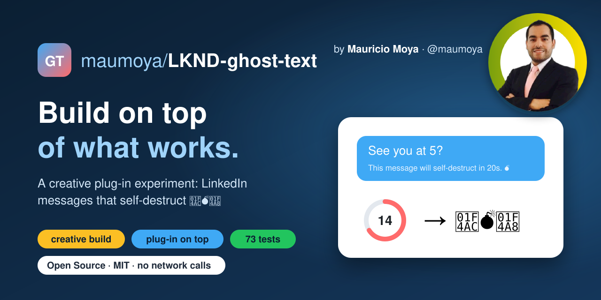

<p align="center"></p>

# 💣 LKND Ghost Text

[](LICENSE)
[](https://github.com/maumoya/LKND-ghost-text)
[](SECURITY.md)
[](extension/manifest.json)
[](test/)

A Chrome extension that sends self-destructing LinkedIn messages. Click 💣 next to send and pick
**20s / 1m / 5m / 30m**. The message goes out with the line
`This message will self-destruct in N seconds/minutes. 💣`, and a countdown ring shows on your
side. At zero the extension edits **your own** message so it reads `💬💣💨`.

If the chat is closed when the timer runs out, it opens the chat quietly in a background tab, makes
the edit, and closes that tab.

Author: Mauricio Alonso Moya Tapia. Not affiliated with, endorsed by or sponsored by LinkedIn.
Use it within LinkedIn's terms; you are responsible for what you send.

## Install (Load unpacked)

1. Download `lknd-ghost-text-v1.0.0.zip` from the
   [latest release](https://github.com/maumoya/LKND-ghost-text/releases/latest) and unzip it
   (or clone this repo).
2. Open `chrome://extensions`, turn on **Developer mode**, click **Load unpacked** and choose the
   unzipped folder (or this repo's `extension/` folder).
3. Open `https://www.linkedin.com/messaging/` and look for 💣 next to the send controls.

## Honest limits

- **It cannot guarantee secrecy.** Screenshots, email copies and push notifications cannot be
  recalled.
- **It runs only while Chrome is open.** If Chrome was closed when the timer ran out, the bomb
  fires at the next start as long as the message is under 55 minutes old (LinkedIn only lets you
  edit for 60 minutes). Older ones are marked missed, with a badge on the icon.
- **LinkedIn will likely show "Edited"** on the exploded message.
- **If LinkedIn changes its page, it fails loudly instead of guessing.** You get a red badge and a
  popup entry with the reason. It only edits a message it can match exactly. If two of your
  messages have the same text, it refuses to edit either.
- Text only. If the composer has an attachment, 💣 sends nothing and says why on the page.
- If a bomb could not be sent, you get a note on the page and a red badge entry; your text stays in
  the box.

## Privacy and safety

- It makes no network calls, uses no external services and has no telemetry. Tests enforce this
  (`test/guards.test.js`).
- Permissions are `storage`, `alarms` and `tabs`, and the only host is
  `https://www.linkedin.com/messaging/*`. It has no cookies, webRequest or scripting permission.
- It never reads or handles your LinkedIn password or tokens. It drives the page you are already
  signed in to.
- The popup has **Cancel all bombs** as a kill switch.

## Develop

```bash
npm ci --ignore-scripts
npm test
```

Tests use `node:test` and jsdom against a fixture recorded from the live page
(`docs/DOM_NOTES.md`). All LinkedIn selectors live in `extension/lib/dom.js` (`SEL`), so a markup
change is a one-line fix.

## License

[MIT](LICENSE). Security reports: see [SECURITY.md](SECURITY.md).
